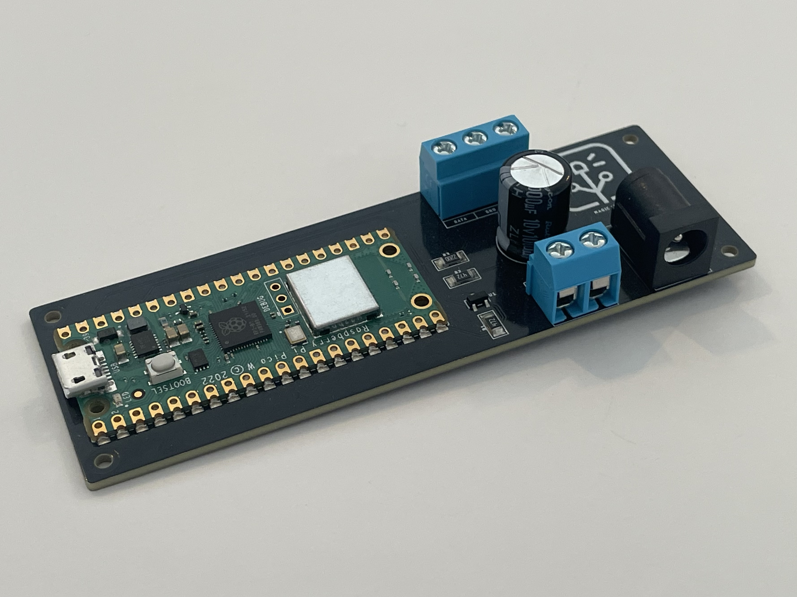

# Magic Lights

Firmware for the Magic Lights board with a Raspberry Pi Pico W. The board is meant to control a light strip of NeoPixel LEDs (or similar individually addressable color LEDs). The firmware exposes HTTP endpoints which serves a simple web UI and a JSON over WebSocket API. The API can be used to select and modify the light fixtures (e.g. a Pacman like game or a rainbow display). The firmware can either create a Wireless access point or connect to one, when it's first powered up the IP address is displayed on the light strip in binary.

By default the firmware creates an access point with following details:

- **SSID**: magic-lights
- **Password**: magic-lights
- **UI address**: http://192.168.4.1



## Schematics

EAGLE schematics are available at [kapetan/magic-lights-schematics](https://github.com/kapetan/magic-lights-schematics).

## Development

At least Python version 3.8 is necessary on the host machine and the Raspberry Pi Pico must be flashed with MicroPython version 1.28.0 or higher.

Following commands will establish the Python environment needed for uploading scripts to the microcontroller.

```
make virtual
$(make virtual-activate)
make requirements-install
```

Going forward only the `$(make virtual-activate)` command is necessary to activate the environment.

If the only plugged in USB device is a single microcontroller use the `deploy` command to upload all the script files. Specify the required build target using the `BUILD` variable (`debug` is the default).

```
make deploy BUILD=release
```

On MacOS this should figure out the correct USB port to use, but in case there are multiple connected devices, it's possible to specify the serial port explicitly.

```
make deploy SERIAL=/dev/tty.usbmodem1420
```

To remove all the files from the microcontorller use `make clean` (note that this will also remove any persisted configuration files).

## Release

A new release is automatically created each time a new tag is pushed to the repository. To create a new version `x.y.z`.

1. Update the `__version__` property in [version.py](magic_lights/version.py) to `x.y.z`.
1. Create a new commit with these changes `git commit -am vx.y.z` (note the version is prefixed with a **v**) and `git push`.
1. Create a new tag `git tag -a vx.y.z -m vx.y.z` and `git push --tags`.
